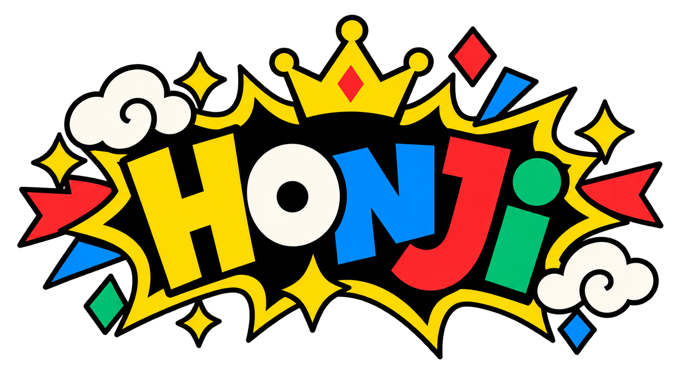

<div align="center">
  

  <h1>Big ideas. Questionable drawings.</h1>

  <p>A multiplayer drawing party game with AI-generated prompts,<br />a ticking clock, and a judge with opinions.</p>

  <p>
    <a href="https://honji.xyz/"><strong>Play Honji ↗</strong></a>
    &nbsp;·&nbsp;
    <a href="#how-to-play">How to play</a>
    &nbsp;·&nbsp;
    <a href="#local-development">Run locally</a>
  </p>

  <p>
    
    
    
  </p>
</div>

---

## The idea

One prompt. Everybody draws. Let the best sketch win.

Honji turns a shared screen and a handful of phones into a drawing competition. Create a room, invite your friends, and race to make an absurd prompt recognizable. AI ranks the finished drawings, awards scores, and delivers a little feedback—with the occasional roast.

**Clear ideas beat perfect art. No drawing talent required.**

## How to play

> **Best setup:** host on a laptop, desktop, or larger shared screen. Each player joins on their own phone to draw. Keep the host screen separate from the players’ devices.

1. **Create a room.** Open [honji.xyz](https://honji.xyz/) and choose **Host a new game**. Share the four-letter room code. The host doesn’t need a player name.
2. **Bring your friends.** Up to 10 players enter a name and the room code, then draw and submit their avatar in the lobby.
3. **Start the round.** Players choose **I’m ready** in the avatar lobby. When everyone is ready, the round starts after a five-second countdown; choosing unready cancels it. The host can also start manually. Everyone receives the same AI-generated prompt.
4. **Beat the clock.** Players have three minutes to draw. Submit early or let the game submit automatically when the countdown reaches zero.
5. **Meet the winner.** AI judges the drawings and assigns rankings, scores, and feedback. The host screen features the top three; each player can browse the full results on their device.
6. **Go again—or call it a night.** Players choose **Play again** or **Leave room**. The host chooses **Play another round** to reopen the avatar lobby, or **Back to home** to close the room. Players who skip replay are excluded from the next round. Joining is available only while the lobby is open.

The home page’s **Instructions** tab keeps the rules close at hand.

## What’s inside

| Feature                    | The experience                                                               |
| :------------------------- | :--------------------------------------------------------------------------- |
| **Room-code multiplayer**  | Join the same game from separate devices, without creating an account.       |
| **Drawn avatars**          | Introduce yourself with a sketch before the round begins.                    |
| **Fresh prompts**          | AI creates a shared drawing challenge using the room’s prompt history.       |
| **Timed drawing**          | A browser canvas with undo, clear, and automatic submission at the deadline. |
| **AI judging**             | Scores from 0–100, ranked submissions, and short, playful reactions.         |
| **A shared podium**        | Gold, silver, and bronze medals on the host’s results screen.                |
| **Mobile-ready results**   | Full-width cards and a scrolling results view for phones.                    |
| **Comic-book personality** | Bold outlines, bright colors, expressive artwork, and plenty of bad art.     |

## Built with

| Layer             | Tools                                   |
| :---------------- | :-------------------------------------- |
| Interface         | React · TypeScript · Vite · CSS Modules |
| Navigation        | React Router                            |
| Drawing           | HTML Canvas · Pointer Events            |
| API & hosting     | Vercel Functions · Vercel               |
| Game state        | Upstash Redis                           |
| Image uploads     | Vercel Blob                             |
| Prompts & judging | OpenAI API · Zod structured outputs     |

The browser polls room state to follow the game from lobby to drawing, judging, and results. Redis holds room, player, round, submission, and score records; Blob stores the uploaded artwork.

## Local development

You’ll need Node.js and npm, a Vercel account, an Upstash Redis database, a **public** Vercel Blob store, and an OpenAI API key.

### 1. Get the project

```bash
git clone https://github.com/dhchung317/honji-pictionary.git
cd honji-pictionary
npm install
```

### 2. Configure the services

Create `.env.local` in the project root with your development credentials:

```dotenv
OPENAI_API_KEY=your-openai-api-key
UPSTASH_REDIS_REST_URL=your-upstash-rest-url
UPSTASH_REDIS_REST_TOKEN=your-upstash-rest-token
BLOB_READ_WRITE_TOKEN=your-vercel-blob-token
```

Link the checkout to your Vercel project when prompted by the local API server. If the project already has environment variables configured in Vercel, you can pull them instead:

```bash
npx vercel link
npx vercel env pull .env.local
```

Use development stores for local work. Environment files are ignored by Git; keep credentials out of the repository.

### 3. Start the app

Run the API in one terminal:

```bash
npm run api
```

Run the interface in a second terminal:

```bash
npm run ui
```

Open the address printed by Vite, normally **http://localhost:5173**. Requests to `/api` are forwarded to the local API server at **http://localhost:3000**.

To test with a phone, open Vite’s network address on a device connected to the same local network.

### Useful commands

| Command                     | Purpose                                                |
| :-------------------------- | :----------------------------------------------------- |
| `npm run ui`                | Start the Vite development server.                     |
| `npm run api`               | Run the API through Vercel’s local development server. |
| `npm run build`             | Type-check and produce the production build.           |
| `npm run preview`           | Preview the built interface locally.                   |
| `npm run lint`              | Run ESLint.                                            |
| `node --test tests/*/*.cjs` | Run the regression tests.                              |

## Project map

```text
src/
  routes/         Home, lobby, drawing, and results screens
  components/     Canvas, avatars, room header, and score medals
  hooks/          Countdown, polling, and game-entry logic
  lib/            API clients and browser session helpers
  styles/         Shared theme, variables, and reset
api/              Game endpoints, stores, and AI integrations
shared/           Types shared by the browser and API
public/           Branding, medal artwork, and score assets
tests/            Regression coverage for game flows and server behavior
docs/review/      Implementation notes and verification guides
```

## Deployment & game data

Deploy through Vercel with the same service environment variables. The repository includes routing rules and a daily Blob cleanup schedule in `vercel.json`.

Rooms are temporary, and uploaded drawings are stored in a public Blob store. Cleanup is opt-in: configure `CRON_SECRET` and review the [Blob cleanup guide](docs/review/blob-cleanup.md) before setting `BLOB_CLEANUP_ENABLED=true`.

For more detail on room expiry, permissions, scoring recovery, and other game behavior, see the [implementation guides](docs/review/README.md).

---

<div align="center">
  <strong>A little competition. A lot of bad art.</strong><br />
  <sub>Made by <a href="https://github.com/dhchung317">Daniel Hyunki Chung</a></sub>
</div>
